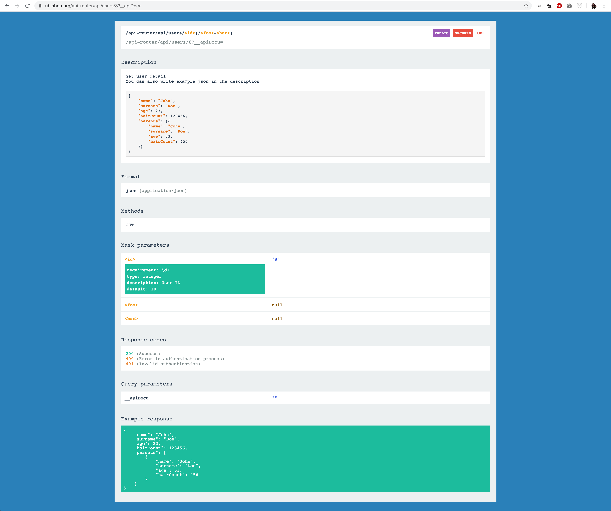
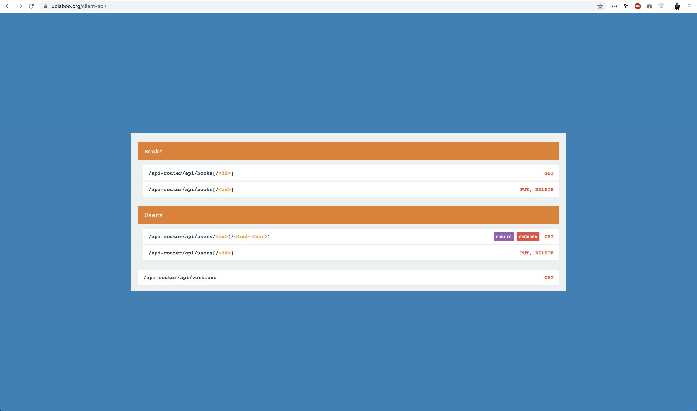

<p align=center>
  <a href="https://github.com/contributte/api-docu/actions"></a>
  <a href="https://coveralls.io/r/contributte/api-docu"></a>
  <a href="https://packagist.org/packages/contributte/api-docu"></a>
  <a href="https://packagist.org/packages/contributte/api-docu"></a>
</p>
<p align=center>
  <a href="https://packagist.org/packages/contributte/api-docu"></a>
  <a href="https://github.com/contributte/api-docu"></a>
  <a href="https://bit.ly/ctteg"></a>
  <a href="https://bit.ly/cttfo"></a>
  <a href="https://contributte.org/partners.html"></a>
</p>

<p align=center>
Website 🚀 <a href="https://contributte.org">contributte.org</a> | Contact 👨🏻‍💻 <a href="https://f3l1x.io">f3l1x.io</a> | Twitter 🐦 <a href="https://twitter.com/contributte">@contributte</a>
</p>

Generate API documentation for routes created using [ApiRouter](https://github.com/contributte/api-router), either from directly defined routes or from annotations.

## Versions

| State  | Version | Branch   | Nette  | PHP     |
|--------|---------|----------|--------|---------|
| dev    | `^6.1`  | `master` | `3.3+` | `>=8.2` |
| stable | `^6.0`  | `master` | `3.3+` | `>=8.2` |

## Installation

To install the latest version of `contributte/api-docu` use [Composer](https://getcomposer.org).

```bash
composer require contributte/api-docu
```

## Usage



ApiDocu can show API documentation for the current route, if there is any. Visit the API URL and add a `?__apiDocu` parameter in your address bar.

### GET Routes

Visit the API URL with the `?__apiDocu` query parameter.

### PUT, POST, DELETE Routes

Browsers can only match routes with the GET method directly. Change the route method using the `?__apiRouteMethod` query parameter. To visit DELETE route API documentation, use a URL such as `/users/10?__apiRouteMethod=DELETE&__apiDocu`.

For example: `/api-router/api/users/8?__apiRouteMethod=PUT&__apiDocu`.

### Presenter Code

```php
<?php

namespace App\ResourcesModule\Presenters;

use Nette;
use Contributte\ApiRouter\ApiRoute;

/**
 * API for managing users
 *
 * @ApiRoute(
 * 	"/api-router/api/users[/<id>]",
 * 	parameters={
 * 		"id"={
 * 			"requirement": "\d+",
 * 			"type": "integer",
 * 			"description": "User ID",
 * 			"default": 10
 * 		}
 * 	},
 *  priority=1,
 *  format="json",
 *  section="Users",
 *  presenter="Resources:Users"
 * )
 */
class UsersPresenter extends Nette\Application\UI\Presenter
{

	/**
	 * Get user detail
	 *
	 * You **can** also write example json in the description
	 *
	 * <json>
	 * {
	 * 	"name": "John",
	 * 	"surname": "Doe",
	 * 	"age": 23,
	 * 	"hairCount": 123456,
	 * 	"parents": {{
	 * 		"name": "John",
	 * 		"surname": "Doe",
	 *	 	"age": 53,
	 * 		"hairCount": 456
	 * 	}}
	 * }
	 * </json>
	 *
	 * @ApiRoute(
	 * 	"/api-router/api/users/<id>[/<foo>-<bar>]",
	 * 	parameters={
	 * 		"id"={
	 * 			"requirement": "\d+",
	 * 			"type": "integer",
	 * 			"description": "User ID",
	 * 			"default": 10
	 * 		}
	 * 	},
	 * 	method="GET",
	 * 	format="json",
	 * 	example={
	 * 		"name": "John",
	 * 		"surname": "Doe",
	 * 		"age": 23,
	 * 		"hairCount": 123456,
	 * 		"parents": {{
	 * 			"name": "John",
	 *			"surname": "Doe",
	 * 			"age": 53,
	 * 			"hairCount": 456
	 * 		}}
	 * 	},
	 * 	tags={
	 * 		"public",
	 * 		"secured": "#e74c3c"
	 * 	},
	 * 	response_codes={
	 *  	200="Success",
	 *  	400="Error in authentication process",
	 *  	401="Invalid authentication"
	 *  }
	 * )
	 */
	public function actionRead($id, $foo = NULL, $bar = NULL)
	{
		$this->sendJson(['id' => $id, 'foo' => $foo, 'bar' => $bar]);
	}


	public function actionUpdate($id)
	{
		$this->sendJson(['id' => $id]);
	}


	public function actionDelete($id)
	{
		$this->sendJson(['id' => $id]);
	}

}
```

## Generating API Documentation



When you are directly on some API URL, you can use the `?__apiDocuGenerate` query parameter to generate whole application API documentation. All documentation files will be available in the directory specified by you. By default, the directory is:

```neon
apiDocu:
	apiDir: "%wwwDir%/api"

extensions:
	apiRouter: Contributte\ApiRouter\DI\ApiRouterExtension
	apiDocu: Contributte\ApiDocu\DI\ApiDocuExtension
```

Example API generation trigger: `/api-router/api/books?__apiDocuGenerate`.

## HTTP Authorization

You can use HTTP authorization on your documentation sites:

```neon
apiDocu:
	apiDir: "%wwwDir%/client-api"
	httpAuth:
		user: foo
		password: bar
```

## Development

See [how to contribute](https://contributte.org/contributing.html) to this package.

This package is currently maintaining by these authors.

<a href="https://github.com/paveljanda">
  
</a>

-----

Consider to [support](https://contributte.org/partners.html) **contributte** development team.
Also thank you for using this package.
